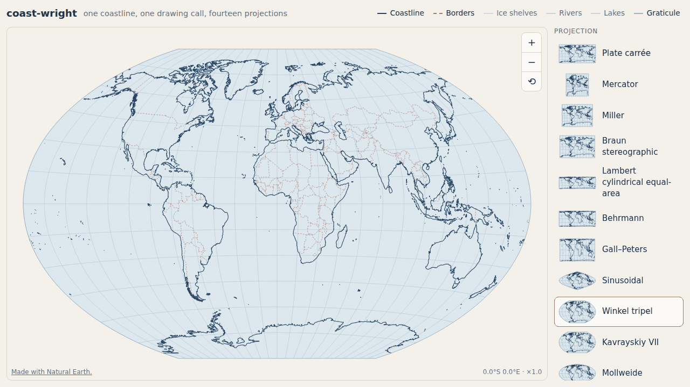

# coast-wright

[][demo]

**[One map, fourteen projections.][demo]** Same coastline, same drawing call.
Scroll to zoom, click to recentre, and cross the date line or a pole without
the map tearing.

> **Alpha.** Lifted from a shipping plugin, tests and all. The API may still
> move before 0.1.

Draw a coastline onto a canvas, through whatever projection you already have.
Hand it [Natural Earth][ne] GeoJSON as published and it draws every island as
is, with no decoder and no simplification in between.

```js
import { geojsonRings, limn } from 'coast-wright'

const coastline = await (await fetch('./ne_50m_coastline.geojson')).json()

limn(ctx, geojsonRings(coastline), ([lon, lat]) => /* → [px, py] */, {
  color: '#8ab',
  centralMeridian: 0,
})
```

No dependencies. No projection of its own. A couple of hundred lines.

## Who is this for?

You are drawing a map on a canvas, in a browser or a [Signal K][sk] plugin,
and you already have a projection or want to choose one. You want the land
where it is, islands included, and no stray line slashed across the Pacific.

## The two things that go wrong at sea

Both look fine in a screenshot. Both fail on a boat.

**The seam.** Where a coastline crosses the date line, two neighbouring
points are a few miles apart on the water and 360 degrees apart in the
numbers. Join them and you get a line clean across the map. The same happens
wherever your map's edge falls, which is why `limn` wants `centralMeridian`: the
longitude your projection measures from. A guard that only knows about the
date line looks right until somebody centres the map on their own boat. A
globe has a seam of a different shape, the far side, so `visible` lets your
projection refuse a point before it is drawn.

**The pole.** Most map libraries bring their own Web Mercator, and Mercator
cannot show a pole. `limn` brings nothing. It takes your
`project` function and asks no questions, so an azimuthal chart over the pole, a band
around a vessel and a plain equirectangular grid are all the same call.

## API

### `geojsonRings(geojson)` → `[[lon, lat], …][]`

Every line and polygon ring in a GeoJSON document, as `[lon, lat]` pairs.
Takes a `FeatureCollection`, a `Feature` or a bare geometry; points are
skipped. This is what you hand to `limn`.

The result is cached per document, since a map redraws on every resize and a
full-detail coastline is tens of thousands of points. Treat it as read-only.
Anything that is not GeoJSON throws rather than drawing something wrong.

### `limn(ctx, rings, project, options)`

Strokes rings onto a canvas 2D context. `project([lon, lat])` returns
`[px, py]`, d3-geo's shape, so a d3 projection is a valid argument as it
stands. On a globe or an azimuthal chart, where a point lands on screen
depends on both its coordinates, so it receives the pair at once.

> **Deprecated:** the pair of callbacks `x(lon, lat)` and `y(lat, lon)` in
> `project`'s place still works, and warns once. The same goes for every
> function below that takes `project`.

`rings` may also be an async iterable of rings, for a source that hands them
over piece by piece. Each ring is drawn as it arrives, exactly as an array's
would be, and `limn` returns a promise that resolves when the iterable ends;
an array or other sync iterable is still drawn before `limn` returns, and
nothing is returned. Draw nothing else on that context until the promise
settles: the rings share its saved state and, with `oneStroke`, its path.

| Option            | Default       |                                                                                                       |
| ----------------- | ------------- | ----------------------------------------------------------------------------------------------------- |
| `color`           | context's own | Stroke style.                                                                                         |
| `alpha`           | `0.45`        | Coastline under data should stay under it.                                                            |
| `width`           | `1`           | Line width in pixels.                                                                                 |
| `lineCap`         | context's own | How a stroke ends where the pen lifts: `'butt'`, `'round'` or `'square'`, the canvas's own `lineCap`. |
| `oneStroke`       | `false`       | A translucent stroke lays down once where rings meet or overlap, instead of darkening at every join.  |
| `centralMeridian` | `0`           | The longitude your projection measures from. Wrong, and the seam guard guards the wrong place.        |
| `visible`         | —             | `(lon, lat) => bool`. Refused points lift the pen: a globe's far side, an azimuthal chart's antipode. |

### `geojsonPolygons(geojson)` → `[[outer, …holes], …]`

Every polygon in a GeoJSON document, holes kept, cached like
`geojsonRings`. Lines and points are skipped. This is what you hand to `fill`
and `trace`.

### `fill(ctx, polygons, project, options)`

Fills land. A polygon that crosses the seam is filled as two shapes meeting
at the map's edge, never as one smeared across it. On a globe, land is cut
at the horizon and closed along it, so only the near side is filled.

`polygons` may also be an async iterable, for a source that hands land over
as it is read or fetched. Each item is a GeoJSON `Polygon` or `MultiPolygon`,
a `Feature` whose geometry is one (holes kept), or a bare `[outer, …holes]`
polygon; anything else, a feature with a null or non-polygon geometry
included, is skipped. Given an async iterable, `fill` and `trace` return a
promise that resolves once the land is traced (and, for `fill`, filled).
Given an array or other sync iterable they run in the call and return
nothing, as before. Draw nothing else on that context until the promise
settles. The rings port, `limn`, is unchanged.

| Option            | Default       |                                                                                                                  |
| ----------------- | ------------- | ---------------------------------------------------------------------------------------------------------------- |
| `color`           | context's own | Fill style.                                                                                                      |
| `alpha`           | `1`           | Opacity.                                                                                                         |
| `rule`            | `'evenodd'`   | Canvas fill rule. Even-odd keeps holes whichever way their rings run; `'nonzero'` if your data promises winding. |
| `centralMeridian` | `0`           | As for `limn`.                                                                                                   |
| `visible`         | —             | As for `limn`: refused land is cut away along the horizon, never projected.                                      |

### `trace(ctx, polygons, project, { centralMeridian, visible })`

The same path as `fill`, left for you to fill or clip. Clip to it to keep a
stroke on the land:

```js
ctx.save();
trace(ctx, geojsonPolygons(land), project, { centralMeridian });
ctx.clip('evenodd');
limn(ctx, geojsonRings(coastline), project, { oneStroke: true, lineCap: 'round', centralMeridian });
ctx.restore();
```

### `withinCap([lon, lat], angle)` → `visible(lon, lat)`

The `visible` that nearly every centred projection wants: admits the points
strictly within `angle` degrees of arc of the centre. `90` is an orthographic
globe's near side; just under `180` (say `179`) is an azimuthal chart with its
antipode refused.

```js
limn(ctx, rings, project, { centralMeridian: -60, visible: withinCap([-60, 45], 90) });
```

### `rhumb([lon, lat], bearing, length, steps = 64)` → `[[lon, lat], …]`

The line a ship sails holding one compass course: `bearing` in degrees
clockwise from north, `length` in degrees of arc (one degree is 60 nautical
miles), as up to `steps + 1` points for `limn` to draw. A portolan chart's
lattice is many of these. It is straight only on Mercator, and it stops at 85°
latitude rather than spiral into the pole.

### The hand: `runs`, `pen`, `simplify`, `meander`, `boundingBox`, `lozenge`, `hatch`

A period chart's rivers wiggle, its lakes are lozenges and its seas are
hatched. These work in pixels, after projection, so a wiggle is one size at
every zoom.

- `runs(rings, project, { centralMeridian, visible })`: pixel runs, the pen lifted where `limn` lifts it.
- `pen(ctx, runs, { close })` adds pixel runs to the current path, to stroke or fill.
- `simplify(run, tolerance)` drops bends smaller than `tolerance` px, before a wave goes on.
- `meander(run, { amplitude, wavelength, phase })`: the run wiggling, still ending where it did.
- `boundingBox(run)` → `{ cx, cy, angle, length, width }`, a shape's box along its long axis.
- `lozenge(box, steps = 24)`: a closed pointed oval on that box.
- `hatch(ctx, polygons, project, { angle, gap, amplitude, dash, … })` strokes parallel lines, clipped.

### `letter(ctx, names, project, options)` → placed names

Letters names onto the chart. A coast's name is set along the coast, on the
land, its letters standing on the shore so that it reads from the sea. A
point's name sits level above the point, or runs inland from the shore it
stands on when given `shore`. Where two names would overlap, the later one is
dropped, so sort the list by importance first. An island too small to carry its
name along its coast gets it level above, as a point would.

```js
letter(
  ctx,
  [
    { text: 'Sicilia', at: sicilyRing }, // a stretch of coast or a whole island ring
    { text: 'Palermo', at: [13.36, 38.12] }, // a point
    { text: 'Malta', at: { type: 'Point', coordinates: [14.4, 35.9] } },
  ],
  project,
  { fonts: ['IM Fell English', 'Georgia', 'serif'], size: 13, color: '#6b2a1a', centralMeridian },
);
```

Each name is `{ text, at, land, fonts, size }`. `at` is `[lon, lat]`,
`[[lon, lat], …]`, or a GeoJSON Point, LineString or MultiLineString geometry.
`land` is which side of the line, walked in order, the land lies: `'left'` by
default, as Natural Earth winds its coastlines, or `'right'`. `fonts` and
`size` override the options for that one name.

coast-wright loads no fonts. `fonts` is a list of family names, tried in
order as a CSS font stack, so a face that has not loaded yet draws in the next
one. Load your own first, with `document.fonts.load('13px "IM Fell English"')`
or a `FontFace`, then draw.

| Option            | Default       |                                                                              |
| ----------------- | ------------- | ---------------------------------------------------------------------------- |
| `fonts`           | `['serif']`   | One family or several (a list, or one CSS stack string), first choice first. |
| `size`            | `12`          | Font size in pixels.                                                         |
| `style`, `weight` | —             | As in a CSS `font`: `'italic'`, `'600'`.                                     |
| `color`           | context's own | Fill style.                                                                  |
| `alpha`           | `1`           | Opacity.                                                                     |
| `gap`             | `0.3 × size`  | Pixels between the coast and the letters.                                    |
| `padding`         | `2`           | Pixels kept clear round each name when testing overlap.                      |
| `upright`         | `true`        | Turn upside-down names round. `false` keeps every name reading from the sea. |
| `centralMeridian` | `0`           | As for `limn`: a coast crossing the seam is lettered on its longer side.     |
| `visible`         | —             | As for `limn`: a name whose place is refused is not drawn.                   |

Returns the names it drew, each `{ text, font, x, y, angle, baseline, box }`.
`place(ctx, names, project, options)` does the layout alone, without drawing.

### Portolano decoding, kept for now

The [portolano][spec] is a compact coastline format from an earlier design.
New work draws GeoJSON instead ([why][pm]); the decoder stays exported until
its retirement is decided, so existing callers keep working:

- `rings(portolano)` → every ring, flattened across polygons, cached per
  document.
- `polygons(portolano)` → `[[outer, …holes], …]`, holes kept. Fill even-odd;
  winding order is not promised.
- `decodeRing(encoded, precision)` → one ring; take `precision` from the
  document, profiles differ.

`rings` and `polygons` refuse a document whose `format` or coordinate order
they do not recognise.

## Data

coast-wright bundles no data: you pass the GeoJSON in.

[Natural Earth][ne] is public domain and publishes its coastline as GeoJSON
at three scales: about 140 KB, 1.6 MB and 10 MB for 110m, 50m and 10m,
a third of that gzipped. Pick the scale by timing
parse and draw on your own target, then pin the version and check the file's
hash at build.

```
https://raw.githubusercontent.com/nvkelso/natural-earth-vector/v5.1.2/geojson/ne_50m_coastline.geojson
```

Natural Earth asks for no credit. If you give one: _Made with Natural Earth._

## Licence

MIT.

[ne]: https://www.naturalearthdata.com/
[sk]: https://signalk.org/
[spec]: https://github.com/mark-brannan/portolani/blob/main/docs/portolano-format.md
[pm]: https://github.com/mark-brannan/portolani/issues/25
[demo]: https://mark-brannan.github.io/coast-wright/
